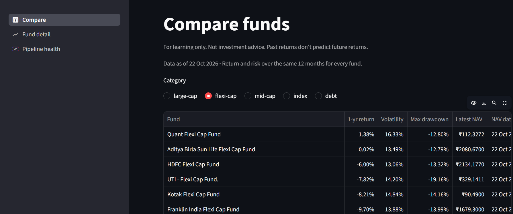
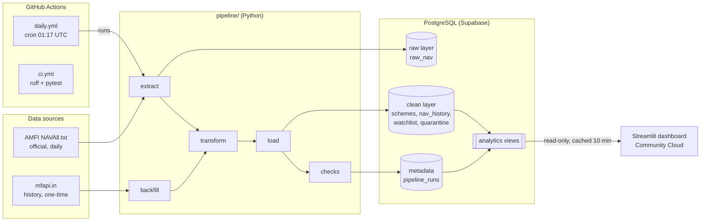
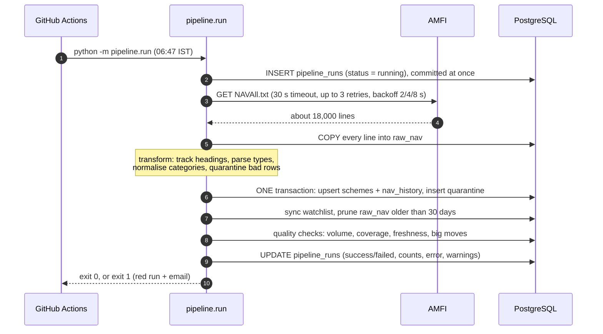
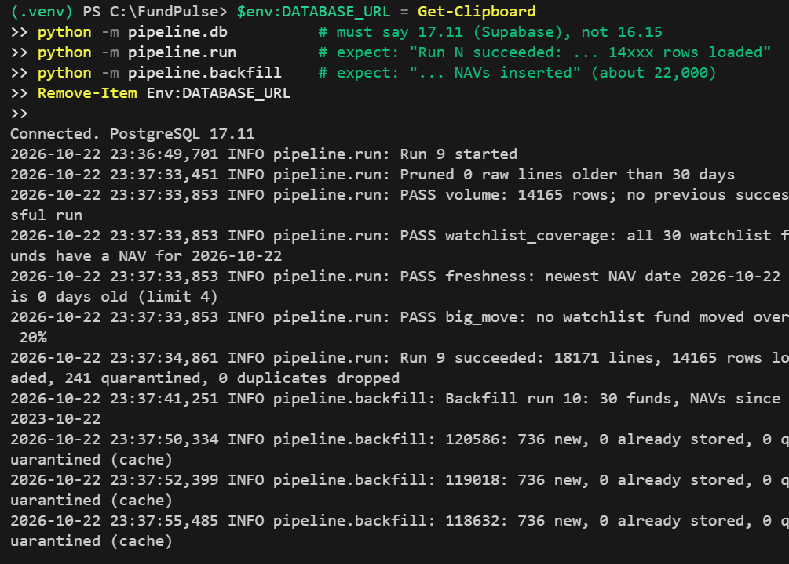
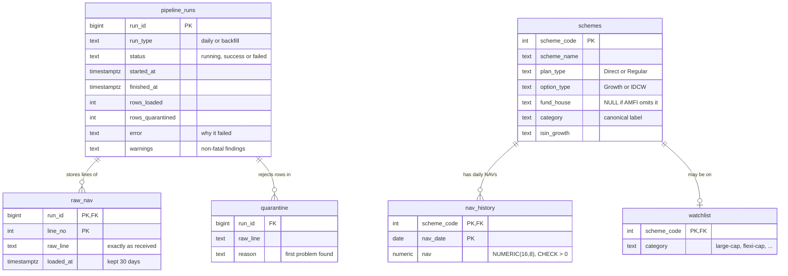
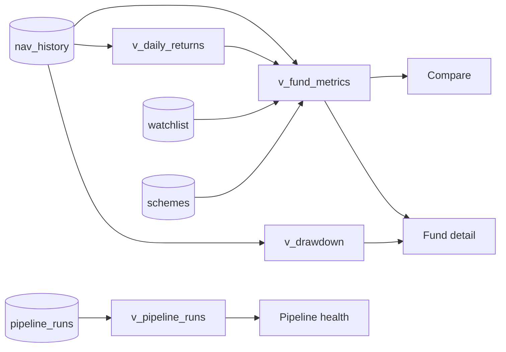
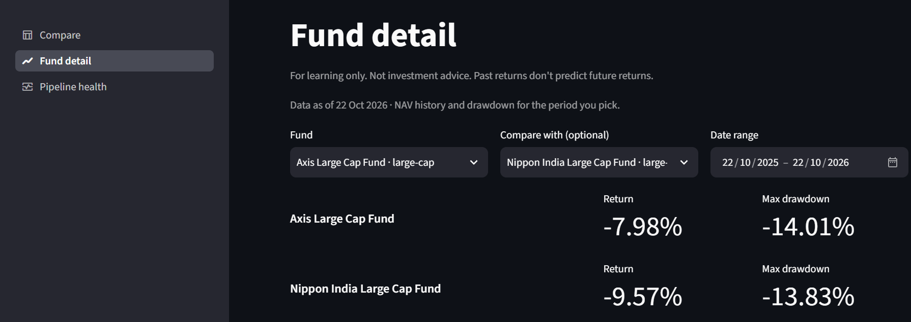
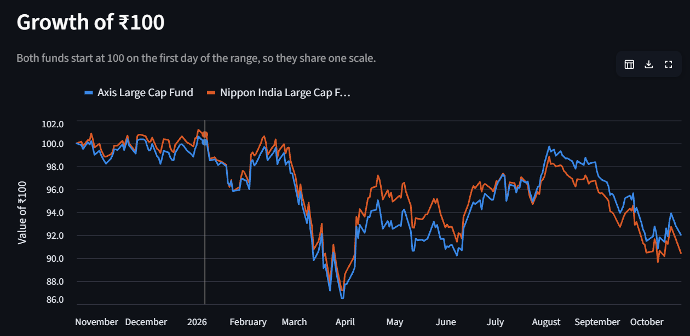
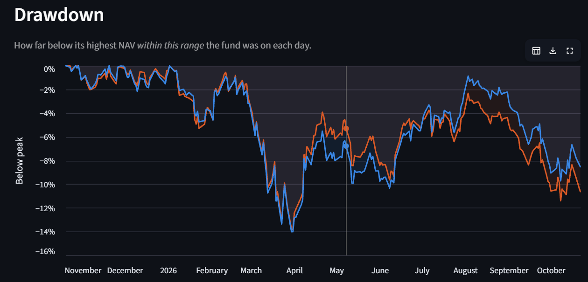
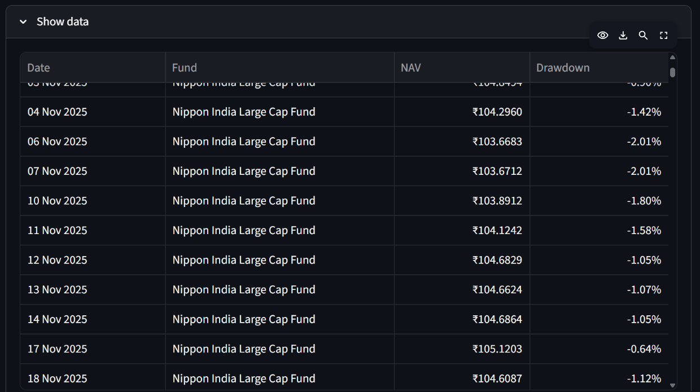

# FundPulse

**An automated daily data pipeline for Indian mutual fund NAVs: from a raw public text file to
tested SQL risk metrics on a live dashboard.**

[](https://github.com/AM2004legend/FundPulse/actions/workflows/ci.yml)
[](https://github.com/AM2004legend/FundPulse/actions/workflows/daily.yml)


**🔗 Live dashboard: [fundpulse.streamlit.app](https://fundpulse.streamlit.app)**



> For learning only. Not investment advice. Past returns don't predict future returns.

---

## Contents

- [The problem](#the-problem)
- [At a glance](#at-a-glance)
- [Architecture](#architecture)
- [How a daily run works](#how-a-daily-run-works)
- [Data model](#data-model)
- [Data quality](#data-quality)
- [Analytics in SQL](#analytics-in-sql)
- [Dashboard](#dashboard)
- [Automation: CI and the daily schedule](#automation-ci-and-the-daily-schedule)
- [Testing](#testing)
- [Engineering decisions](#engineering-decisions)
- [Run it locally](#run-it-locally)
- [Deploy your own](#deploy-your-own)
- [Operations runbook](#operations-runbook)
- [Limitations and next steps](#limitations-and-next-steps)
- [Project structure](#project-structure)
- [Data sources](#data-sources)

---

## The problem

Every business day AMFI (the Association of Mutual Funds in India) publishes the NAV, the price
of one unit, of every mutual fund scheme in India. The data is public, but it arrives as **one
large semicolon-separated text file** with section headings mixed in between data rows,
inconsistent category names, `N.A.` values and zero NAVs.

A single day's file says nothing about risk. Comparing funds fairly needs **clean history** and
risk numbers such as **volatility** and **maximum drawdown**, not just the latest return.
FundPulse builds that history automatically and safely, every day, with no manual steps.

## At a glance

| | |
|---|---|
| **Volume** | Ingests the full AMFI file every day: about 18,000 lines covering 14,000+ schemes |
| **Watchlist** | 30 Direct-Growth funds across 5 categories (large-cap, flexi-cap, mid-cap, index, debt), each with about 3 years of history |
| **Safety** | Idempotent upserts, one transaction per load, bad rows quarantined with a reason |
| **Quality** | 4 automated checks after every load; every run logged in `pipeline_runs` |
| **Analytics** | 4 SQL views built on window functions (`LAG`, running `MAX`, `STDDEV_SAMP`) |
| **Tests** | 89 pytest tests against a real PostgreSQL, run in CI on every push |
| **Automation** | GitHub Actions cron every morning at 06:47 IST, plus a manual trigger |
| **Hosting** | Supabase (PostgreSQL) and Streamlit Community Cloud, both on free tiers |

**Stack:** Python 3.12 · pandas · psycopg 3 with plain SQL (no ORM) · PostgreSQL · requests ·
Streamlit · pytest · ruff · Docker Compose · GitHub Actions

---

## Architecture



Three rules shape the design:

1. **Layers stay separate.** `raw_nav` keeps the file exactly as received, the clean tables hold
   typed and validated data, and `pipeline_runs` records what happened. A bad parse can always be
   traced back to the original line.
2. **The database owns the maths.** Every metric is a SQL view. Python moves and validates data,
   and SQL computes the metrics.
3. **The dashboard has one contract: the views.** It never imports the pipeline and never reads a
   table directly. It connects read-only and is deployed on its own.

---

## How a daily run works



1. **Log the start.** The `running` row is committed straight away, so even a crash leaves a trace.
2. **Extract.** Download politely: a timeout, at most 3 retries with exponential backoff, and no
   retries on a 4xx error (retrying a wrong request won't help). Every line is saved to `raw_nav`.
3. **Transform.** Walk the file while remembering the current *category* and *fund house*
   headings. Convert types (NAV to `Decimal`, date from `DD-Mon-YYYY`), map AMFI's two spellings
   of each category to one canonical label, and quarantine anything invalid.
4. **Load.** Upsert schemes, then NAVs, then quarantined rows, inside **one transaction**. A
   failure halfway leaves the database exactly as it was.
5. **Check.** Run the four quality checks (see [Data quality](#data-quality)).
6. **Log the end.** Record status, counts, the error and warnings. The exit code tells GitHub
   whether the run passed.

The first production run:



**Backfill** (`python -m pipeline.backfill`) is a one-time history load for the watchlist. It
turns mfapi.in's JSON into the same `;`-separated lines as AMFI's file and sends them through
the **same parser**, so history gets the same validation and quarantine rules as daily data.
Responses are cached on disk, so re-runs make no network requests.

---

## Data model



| Layer | Tables | Purpose |
|---|---|---|
| **Raw** | `raw_nav` | Every line of the downloaded file, unchanged. Kept for 30 days for debugging recent loads. |
| **Clean** | `schemes`, `nav_history`, `watchlist`, `quarantine` | Typed, validated data. `(scheme_code, nav_date)` is the primary key that makes loads idempotent. |
| **Metadata** | `pipeline_runs` | One row per run: timings, counts, status, error and warnings. |
| **Analytics** | 4 views | Metrics computed on demand from the clean layer. The dashboard reads only these. |

How the views build on each other and which dashboard page reads each one:



---

## Data quality

**Quarantine, never silently drop.** Each invalid row is stored in `quarantine` with the first
reason found:

| Reason | Example |
|---|---|
| NAV is not a number | `N.A.` |
| NAV is zero | Segregated portfolios: 241 such rows in a typical day's file |
| Wrong number of fields, non-numeric scheme code, empty name, bad date, NAV too large | Malformed lines |
| Row not under a category heading | Data before the first heading |
| Conflicting duplicate | Same scheme and date with two *different* NAVs: all copies quarantined |

Exact duplicates (same scheme, date and NAV) are kept once and counted. Rows that AMFI lists
without a fund-house heading are kept with `fund_house = NULL`, because their NAV is still valid.

**Checks after every load:**

| Check | Severity | Rule |
|---|---|---|
| `volume` | fail | Rows loaded ≥ 90% of the last successful daily run |
| `watchlist_coverage` | fail | Every watchlist fund has a NAV for the file's newest date |
| `freshness` | fail | Newest NAV date is at most 4 days old |
| `big_move` | warn | No watchlist fund moved more than 20% from its previous NAV |

Checks run **after** the load. Upserts never delete data, so a suspicious file can't destroy
history. A failed check marks the run `failed` and exits 1 to alert a human, but keeps the data.

---

## Analytics in SQL

All three Compare metrics use the **same trailing year**, from the last NAV on or before
(latest date − 365 days) to each fund's latest NAV, so funds are compared like for like.

| Metric | Definition | SQL technique |
|---|---|---|
| Daily return | `nav / previous nav − 1` | `LAG(nav) OVER (PARTITION BY scheme_code ORDER BY nav_date)` |
| 1-year return | `latest NAV / base NAV − 1` | `LATERAL` join for the "last available date on or before" lookup |
| Volatility | `STDDEV_SAMP(daily return) × √250` | Aggregate over the window's output |
| Max drawdown | `MIN(nav / running peak − 1)` | `MAX(nav) OVER (… ROWS UNBOUNDED PRECEDING)` |

NAVs exist only on business days, so a return across a weekend or holiday is one step
(Friday → Monday), and every "N days ago" lookup uses the last available date on or before the
target. A fund with less than a year of history gets `NULL` metrics rather than misleading
numbers over a shorter period.

<details>
<summary><b>Sample queries</b> (run them in any SQL client against the database)</summary>

```sql
-- Compare large-cap funds on return AND risk
SELECT scheme_name,
       round(return_1y * 100, 1)       AS return_pct,
       round(volatility_1y * 100, 1)   AS volatility_pct,
       round(max_drawdown_1y * 100, 1) AS max_drawdown_pct
FROM v_fund_metrics
WHERE category = 'large-cap'
ORDER BY return_1y DESC NULLS LAST;

-- Daily return with LAG: PARTITION BY keeps each fund's rows separate
SELECT scheme_code, nav_date, nav,
       nav / LAG(nav) OVER (PARTITION BY scheme_code ORDER BY nav_date) - 1 AS daily_return
FROM nav_history
WHERE scheme_code = 119018
ORDER BY nav_date DESC
LIMIT 5;

-- Worst fall from a peak, using a running MAX
SELECT nav_date, nav, running_peak, round((nav / running_peak - 1) * 100, 1) AS drawdown_pct
FROM (
    SELECT nav_date, nav,
           MAX(nav) OVER (PARTITION BY scheme_code ORDER BY nav_date) AS running_peak
    FROM nav_history
    WHERE scheme_code = 119018
) AS t
ORDER BY nav / running_peak
LIMIT 1;

-- Recent pipeline runs
SELECT run_id, run_type, status, started_at_ist, duration_seconds, rows_loaded, rows_quarantined
FROM v_pipeline_runs
ORDER BY run_id DESC
LIMIT 7;
```

</details>

---

## Dashboard

Three pages, each showing **"Data as of"** with the newest NAV date, plus the disclaimer. Queries are cached for
10 minutes, which protects the free database from being queried on every page view.

**Compare** (screenshot at the top of this page): the watchlist funds in one category with
1-year return, volatility and max drawdown. Sortable, with a CSV download.

**Fund detail:** one fund, or two side by side, over any date range.



Both funds are rebased to ₹100 on the first day of the range so they share one scale:



Drawdown shows how far each fund sits below its highest NAV so far in the range:



<details>
<summary>The numbers behind the charts ("Show data")</summary>



</details>

**Pipeline health:** the last 30 runs with status, row counts, duration and warnings. Pick a
failed run to read its error. Failures are visible, not buried in logs.

---

## Automation: CI and the daily schedule

| Workflow | Trigger | What it does |
|---|---|---|
| [`ci.yml`](.github/workflows/ci.yml) | Every push and pull request | Starts a PostgreSQL 16 service container, then runs `ruff check`, `ruff format --check` and `pytest` |
| [`daily.yml`](.github/workflows/daily.yml) | Cron `17 1 * * *` (06:47 IST) and a manual **Run workflow** button | Runs `python -m pipeline.run` against the production database |

- **Why 06:47 IST:** AMFI keeps updating the file late into the night, so by early morning the
  previous day's NAVs are complete. GitHub cron is always UTC (01:17 UTC = 06:47 IST), and an odd
  minute avoids the top of the hour, when scheduled runs are most often delayed.
- **No overlaps:** a `concurrency` group means a manual run can never overlap the scheduled one.
- **Secrets:** the database URL lives only in a GitHub secret, Streamlit's secrets and a local
  `.env` (git-ignored). The repo contains only [`.env.example`](.env.example).
- **Alerting:** a failed run turns red, and GitHub emails the repository owner.

---

## Testing

89 tests, run against a **real PostgreSQL**. The test database is created automatically and
emptied before each test, and must be named `*_test`, so development data is never touched.

| File | Tests | What it covers |
|---|---|---|
| `test_transform.py` | 18 | Parser on a byte-exact trimmed copy of the real file: headings, `N.A.`, zero NAVs, duplicates, 8-decimal NAVs |
| `test_dashboard.py` | 11 | Every page renders (Streamlit `AppTest`), including empty-database states |
| `test_checks.py` | 10 | Each quality check's pass and fail paths |
| `test_load.py` | 10 | **Idempotency** (load twice → same row counts), in-place NAV corrections, exact decimals, raw-line retention |
| `test_backfill.py` | 8 | mfapi.in adapter, cache, "official file wins" conflict rule |
| `test_views.py` | 8 | Every metric on a **hand-made NAV series with known answers** |
| `test_extract.py` | 6 | Retries with backoff, no retry on 4xx (network faked) |
| `test_run.py` | 5 | End-to-end runs: success, failed check, failed download, failed load, pruning |
| `test_setup.py` | 2 | Schema smoke tests |

The tests never touch the network: a fake session stands in for `requests`.

---

## Engineering decisions

| Decision | Why | Trade-off |
|---|---|---|
| `INSERT … ON CONFLICT (scheme_code, nav_date) DO UPDATE` | Re-running a day changes nothing, so retries are always safe | Needs a natural key, which the data provides |
| One transaction per load | All or nothing: no half-loaded days | A single bad batch rolls back the whole day (by design) |
| `NUMERIC(16,8)` for NAV | Some NAVs have 8 decimals; floats can't store them exactly | Slightly slower maths than floats |
| Quarantine instead of drop | Every rejected line can be explained | One more table to monitor |
| Plain SQL with psycopg, no ORM | Window functions and upserts are clearer in SQL | More SQL to write and test by hand |
| Metrics as plain views, not materialized | Always current, nothing to refresh | Computed on each query; fine at this size and cached by the dashboard |
| Checks after the load | Upserts can't destroy history, so the checks only need to alert | Suspicious data is visible until someone acts |
| Backfill from mfapi.in with `DO NOTHING` | 30 small requests instead of about 800 MB from AMFI's archive; values matched AMFI on a spot check | Community source, so the official daily file always wins |
| `raw_nav` kept for 30 days | About 3 MB per day would fill a 500 MB free database in months | Raw lines older than a month are gone (the clean data stays) |
| Dashboard reads only views, read-only | The pipeline and dashboard deploy independently | Any new metric needs a view first |

---

## Run it locally

Needs **Python 3.12** and **Docker Desktop**. Commands are for PowerShell; bash differences are
in the comments.

```powershell
git clone https://github.com/AM2004legend/FundPulse.git
cd FundPulse
py -3.12 -m venv .venv
.venv\Scripts\Activate.ps1            # bash: source .venv/bin/activate
pip install -r requirements-dev.txt
Copy-Item .env.example .env           # bash: cp .env.example .env

docker compose up -d --wait db        # PostgreSQL 16; applies sql/schema.sql + views.sql
python -m pipeline.run                # load today's file
python -m pipeline.backfill           # about 3 years of history for the 30 watchlist funds
streamlit run dashboard/app.py        # http://localhost:8501

pytest                                # uses a separate fundpulse_test database
ruff check . ; ruff format --check .  # bash: use && instead of ;
```

Useful extras: `python -m pipeline.db` checks the connection, `docker compose exec db psql -U
fundpulse -d fundpulse` opens a SQL shell, and `docker compose down -v` wipes local data.

---

## Deploy your own

| Piece | Where | Configuration |
|---|---|---|
| Database | [Supabase](https://supabase.com) free tier | Use the **Session pooler** connection string (port 5432) |
| Daily load | GitHub Actions | Repository secret `DATABASE_URL` set to the bare URI |
| Dashboard | [Streamlit Community Cloud](https://share.streamlit.io) | Main file `dashboard/app.py`; Secrets: `DATABASE_URL = "<uri>"` |

1. Create a Supabase project, open **Connect**, and copy the **Session pooler** URI. GitHub
   Actions connects over IPv4 only, and Supabase's direct connection is IPv6. Turn off the Data
   API (Project Settings → API), because the project doesn't use it.
2. Initialise the database from your machine:

   ```powershell
   $env:DATABASE_URL = Get-Clipboard   # keeps the password out of your terminal history
   python -m pipeline.db               # check which database you're connected to
   python -m pipeline.db --init        # tables + views (safe to re-run)
   python -m pipeline.run              # first load creates the schemes
   python -m pipeline.backfill         # history for the watchlist
   Remove-Item Env:DATABASE_URL
   ```

3. Add the `DATABASE_URL` secret on GitHub and run **Daily NAV load** once from the Actions tab.
4. Deploy the dashboard on Streamlit Community Cloud with the secret above.

---

## Operations runbook

What failures look like, from the real deployment of this project:

| Symptom | Cause | Fix |
|---|---|---|
| Run failed: `HTTP 503` after 4 attempts | AMFI's site was down for scheduled maintenance | Nothing to fix: the run is logged as failed and the next run catches up, because loads are idempotent |
| `HTTP 404`, not retried | File temporarily missing (e.g. just after maintenance) | Same as above. 4xx errors fail fast by design |
| `invalid connection option "DATABASE_URL"` | The GitHub secret contained `DATABASE_URL = "…"` instead of the bare URI | Paste only `postgresql://…` into the GitHub secret |
| `database "postgre" does not exist` | Typo in the connection string | The URI must end in `/postgres` |
| `failed to resolve host '…]@aws-0-…'` | Password contains `@`, which ends the password part of a URI | URL-encode it (`%40`) or use a password of letters and digits |
| Dashboard says "No data yet" right after a load | The 10-minute query cache still holds the earlier empty answer | Wait, or use the app menu → Clear cache |
| Connected to the wrong database | `DATABASE_URL` not set, so `.env` (local Docker) was used | `python -m pipeline.db` prints the server version, which shows which database you're on |
| Scheduled runs stopped | GitHub disables cron after 60 days without repository activity | Re-enable the workflow in the Actions tab |

---

## Limitations and next steps

### Known limits

- **Storage:** the free database holds 500 MB. With 30-day raw retention, `nav_history` grows by
  about 1 MB per trading day, which leaves room for roughly a year.
- **Schedule timing:** GitHub cron can start late when GitHub is busy.
- **Cold start:** the Streamlit app sleeps when nobody visits for a while, and the first visitor
  wakes it (about a minute).
- **Volatility:** annualised with √250 for every fund. Liquid funds publish on about 326 days a
  year, so their volatility is slightly understated.

### Ideas, not yet built

- A read-only database role limited to the views, for the dashboard.
- A scheduled keep-alive so GitHub never disables the daily workflow.
- Apply `sql/views.sql` automatically on deploy instead of by hand.

---

## Project structure

```text
FundPulse/
├── pipeline/
│   ├── config.py        settings, watchlist + category map paths, raw retention
│   ├── db.py            the one place that opens connections; --init applies the SQL
│   ├── extract.py       download with timeout, retries and backoff
│   ├── transform.py     parse headings + rows -> (clean, quarantined)
│   ├── load.py          upserts in one transaction, run logging, raw pruning
│   ├── checks.py        volume, coverage, freshness, big-move checks
│   ├── run.py           one daily run, end to end
│   └── backfill.py      one-time history load from mfapi.in (cached)
├── sql/
│   ├── schema.sql       tables, keys, constraints
│   └── views.sql        v_daily_returns, v_drawdown, v_fund_metrics, v_pipeline_runs
├── dashboard/           Streamlit app: pages/, cached read-only queries, charts
├── data/
│   ├── watchlist.csv    30 funds, 6 per category
│   └── category_map.csv AMFI heading -> canonical category
├── tests/               89 pytest tests + fixtures from the real files
├── screenshots/         images used in this README
├── .github/workflows/   ci.yml, daily.yml
├── docker-compose.yml   local PostgreSQL 16
└── docs/PRD.md          product requirements
```

---

## Data sources

- **[AMFI daily NAV file](https://portal.amfiindia.com/spages/NAVAll.txt):** official, downloaded
  once a day.
- **[mfapi.in](https://www.mfapi.in/):** community-run API, used only for the one-time backfill
  (one cached request per fund).

Built by [Aritra](https://github.com/AM2004legend) as a learning project. The data belongs to its
publishers. Nothing here is investment advice.
