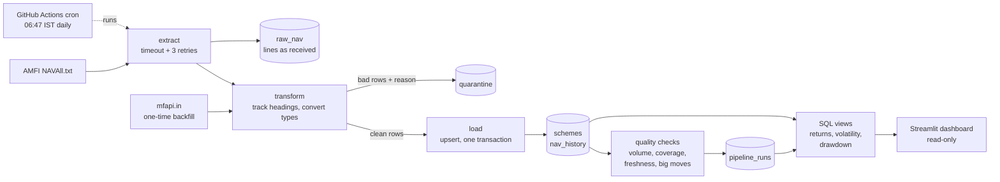

# FundPulse

[](https://github.com/AM2004legend/FundPulse/actions/workflows/ci.yml)
[](https://github.com/AM2004legend/FundPulse/actions/workflows/daily.yml)

**Live dashboard:** _link added after deployment_

FundPulse is an automated daily data pipeline for Indian mutual funds. Every morning it downloads
the official NAV file published by AMFI (about 18,000 lines covering 14,000+ schemes), cleans it,
loads it into PostgreSQL without ever duplicating data, and computes return and risk metrics with
SQL window functions. A Streamlit dashboard compares 30 watchlist funds on return **and** risk.

> For learning only. Not investment advice. Past returns don't predict future returns.

## How it works



One daily run (`python -m pipeline.run`):

1. **Log the start.** Insert a `pipeline_runs` row with status `running`. It is committed straight
   away, so even a crash leaves a visible trace.
2. **Extract.** Download `NAVAll.txt` (timeout, up to 3 retries with backoff) and save every line
   into `raw_nav` exactly as received.
3. **Transform.** Parse the semicolon-separated file while remembering the current fund house and
   category headings, then normalise AMFI's two spellings of each category. Rows with a NAV that
   is not a number (`N.A.`) or is zero are quarantined with a reason.
4. **Load.** Upsert schemes, then NAVs, in **one transaction**, so the load is all or nothing.
5. **Check.** Fail the run if the volume drops below 90% of the last good run, a watchlist fund
   has no latest NAV, or the newest NAV is more than 4 days old. Warn on any move above 20% in
   one day.
6. **Log the end.** Record status, row counts, the error and any warnings.

## Key design decisions

| Decision | Why |
|---|---|
| `INSERT ... ON CONFLICT (scheme_code, nav_date) DO UPDATE` | **Idempotent:** re-running a day leaves row counts unchanged (tested). |
| NAV stored as `NUMERIC(16,8)` | Some NAVs have 8 decimals, and floats can't store them exactly. |
| Bad rows go to `quarantine` with a reason | Nothing is silently dropped, and every rejected line can be explained. |
| `raw_nav` kept separate from the clean tables | The raw layer shows exactly what the source sent. It keeps the last 30 days, about 3 MB per daily file; the clean tables keep full history. |
| Checks run **after** the load | Upserts never delete data, so a failed check raises an alert (red run, exit 1) without blocking the load. |
| Backfill uses `ON CONFLICT DO NOTHING` | mfapi.in is community-run, so the official AMFI value always wins. Any differences are reported as warnings. |
| Metrics are SQL **views**, and the dashboard reads only views | The dashboard connects read-only and never imports the pipeline. Its only contract is `sql/views.sql`. |

## Metrics (in `sql/views.sql`)

| Metric | How |
|---|---|
| Daily return | `nav / LAG(nav) OVER (PARTITION BY scheme_code ORDER BY nav_date) - 1` |
| 1-year return | Latest NAV divided by the last NAV on or before (latest date - 365 days), minus 1 |
| Volatility | `STDDEV_SAMP(daily return) * sqrt(250)` over the same trailing year |
| Max drawdown | `MIN(nav / running MAX(nav) - 1)` over the same trailing year |

NAVs exist only on business days, so every "N days ago" lookup uses the last available date on
or before the target date.

### Sample SQL

```sql
-- Compare large-cap funds on return AND risk
SELECT scheme_name,
       round(return_1y * 100, 1)       AS return_pct,
       round(volatility_1y * 100, 1)   AS volatility_pct,
       round(max_drawdown_1y * 100, 1) AS max_drawdown_pct
FROM v_fund_metrics
WHERE category = 'large-cap'
ORDER BY return_1y DESC NULLS LAST;

-- Daily return with LAG: PARTITION BY keeps each fund's rows separate
SELECT scheme_code, nav_date, nav,
       nav / LAG(nav) OVER (PARTITION BY scheme_code ORDER BY nav_date) - 1 AS daily_return
FROM nav_history
WHERE scheme_code = 119018
ORDER BY nav_date DESC
LIMIT 5;

-- Worst fall from a peak, using a running MAX
SELECT nav_date, nav, running_peak, round((nav / running_peak - 1) * 100, 1) AS drawdown_pct
FROM (
    SELECT nav_date, nav,
           MAX(nav) OVER (PARTITION BY scheme_code ORDER BY nav_date) AS running_peak
    FROM nav_history
    WHERE scheme_code = 119018
) AS t
ORDER BY nav / running_peak
LIMIT 1;

-- Recent pipeline runs
SELECT run_id, run_type, status, started_at_ist, duration_seconds, rows_loaded, rows_quarantined
FROM v_pipeline_runs
ORDER BY run_id DESC
LIMIT 7;
```

## Dashboard

- **Compare:** watchlist funds in one category with 1-year return, volatility and max drawdown.
  The table is sortable and can be downloaded as CSV.
- **Fund detail:** NAV history and drawdown charts for up to two funds, over a chosen date range.
- **Pipeline health:** the last 30 runs with status, row counts and duration. Failed runs show
  their error.

## Run it locally

Needs Python 3.12 and Docker Desktop. Commands are for PowerShell; bash differences are noted.

```powershell
git clone https://github.com/AM2004legend/FundPulse.git
cd FundPulse
py -3.12 -m venv .venv
.venv\Scripts\Activate.ps1            # bash: source .venv/bin/activate
pip install -r requirements-dev.txt
Copy-Item .env.example .env           # bash: cp .env.example .env

docker compose up -d --wait db        # Postgres 16; applies sql/schema.sql + views.sql
python -m pipeline.run                # load today's file
python -m pipeline.backfill           # ~3 years of history for the 30 watchlist funds
streamlit run dashboard/app.py

pytest                                # uses a separate fundpulse_test database
ruff check . ; ruff format --check .  # bash: use && instead of ;
```

## Deployment

| Piece | Where | Secret |
|---|---|---|
| Database | Supabase free tier (Postgres) | Session pooler connection string |
| Daily load | GitHub Actions, `.github/workflows/daily.yml` (cron `17 1 * * *` = 06:47 IST, plus a manual "Run workflow" button) | `DATABASE_URL` repository secret |
| Dashboard | Streamlit Community Cloud, main file `dashboard/app.py` (installs `dashboard/requirements.txt`) | `DATABASE_URL` in the app's Secrets |
| CI | GitHub Actions, `.github/workflows/ci.yml`: ruff + pytest against a Postgres 16 service container on every push | none |

GitHub Actions runners connect over IPv4 only, and Supabase's direct connection is IPv6, so both
the workflow and the dashboard use Supabase's **session pooler** URL. To set up a new database,
run once from your machine with `DATABASE_URL` pointing at it:

```powershell
python -m pipeline.db --init    # create tables + views (safe to re-run; repeat after changing views.sql)
python -m pipeline.run          # first daily load, so the schemes exist
python -m pipeline.backfill     # history for the watchlist
```

### Known limits

- **Storage:** the free database holds 500 MB. Raw files are pruned after 30 days (about 90 MB
  kept), and `nav_history` grows by about 1 MB per trading day, which leaves room for about a
  year.
- **Scheduled runs** can start late when GitHub is busy. GitHub also disables them after 60 days
  without repository activity, so re-enable the workflow from the Actions tab if that happens.
- **Supabase free projects** pause after a week of inactivity. The daily load counts as activity.
- **The Streamlit app sleeps** when nobody visits for a while. The first visitor wakes it up,
  which takes about a minute.

## Project layout

```
pipeline/   config, db, extract, transform, load, checks, run (daily), backfill (one-time)
sql/        schema.sql (tables), views.sql (metrics)
dashboard/  Streamlit app: pages/, cached read-only queries, charts
data/       watchlist.csv (30 funds), category_map.csv (AMFI heading -> canonical category)
tests/      pytest: parser on a real trimmed fixture, idempotent loads, checks, metrics on a
            hand-made series with known answers, dashboard pages (Streamlit AppTest)
docs/PRD.md requirements
```

## Data sources

- [AMFI daily NAV file](https://portal.amfiindia.com/spages/NAVAll.txt): official, used every day.
- [mfapi.in](https://www.mfapi.in/): community-run, used only for the one-time backfill (one
  cached request per fund).
